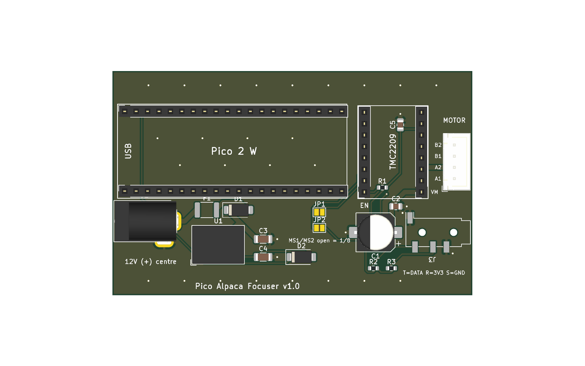

# Focuser carrier PCB

An 80 × 50 mm, 2-layer carrier board for the Pico 2 W focuser. JLCPCB makes and assembles
it; you plug in your own **Raspberry Pi Pico 2 W** and **BigTreeTech TMC2209 v1.3**.
A single 12 V supply powers the motor and the Pico.



## Ordering at JLCPCB

Everything to upload is in `fab/`:

1. **PCB:** upload `focuser-gerbers.zip`. Keep the defaults: 2 layers, 1.6 mm, any colour.
2. **Assembly:** turn on *PCB Assembly*, **top side**. The sockets, barrel jack, motor
   connector and U1 are through-hole, so make sure through-hole assembly is included.
3. Upload **`focuser-bom-jlc.csv`** (BOM) and **`focuser-cpl-jlc.csv`** (pick and place).
4. **U1 (RECOM R-78E5.0-0.5)** is JLCPCB part **C18212367** (Extended). If it is ever out of
   stock, any 7805-pinout 5 V switching module with at least 15 V input and at least 0.5 A
   fits the same holes (pin 1 = VIN in the square pad): RECOM R-78E5.0-1.0, Mornsun or DEXU
   K7805-500R3 (LCSC C909662), Traco TSR 1-2450.
5. **Check the placement preview before paying.** JLCPCB's parts don't always share KiCad's
   zero rotation. Look especially at:
   - the **polarity** of D1/D2 (stripe = cathode) and C1 (+)
   - that **J1** and **J3** face outwards at the board edges

   Fix rotations in the preview if needed.
6. Solder jumpers JP1/JP2 are pads only; nothing is placed on them.

## Using the board

| Connector | Pinout |
|---|---|
| **J1** 12 V barrel jack | 5.5 × 2.1 mm plug, **centre positive**, 12 V. The jack (XUNPU DC-005-A200) is rated 0.5 A, which is enough for a focuser at modest motor current. |
| **J2** motor (JST XH 4-pin) | 1 = A1, 2 = A2, 3 = B1, 4 = B2. **A1/A2 must be one coil, B1/B2 the other.** Check with a multimeter: a few ohms within a coil, open circuit between coils. |
| **J3** 3.5 mm jack, DS18B20 (rear edge, below the 12 V jack) | Tip = data (GP22, 4.7 kΩ pull-up on the board), Ring = 3.3 V (through 100 Ω), Sleeve = GND. Use a 3-pole (TRS) plug. |
| USB | The Pico's own USB port, next to J1, for flashing. USB and 12 V can be connected at the same time. |

**Plugging in the modules**
- **Pico 2 W:** USB end towards the J1 edge (silkscreen "USB"), components facing up.
- **TMC2209:** components (heatsink) up, with its **EN** pin in the hole marked **EN** and its
  **VM** pin in the hole marked **VM**. Both are at the end nearest the motor connector; the
  logic row (EN…DIR) is on the board-edge side. Plugging it in any other way puts 12 V on the
  wrong pins and destroys the driver, so check before applying power.
- Set the motor current with the TMC2209's potentiometer *before* connecting the motor. A
  focuser needs little torque: start low.

**Microstepping:** JP1/JP2 open (default) = 1/8 step, which is what the firmware assumes.
Bridging them with solder changes MS1/MS2. See the TMC2209 datasheet, and update `max_step` in `config.toml`.

**Wi-Fi:** the Pico's antenna end (opposite USB) has no copper under it (datasheet keep-out,
14 × 9 mm) and the driver sits more than 10 mm away. Don't put metal near that end in the case.

**Mounting:** no screw holes. The board slides into slots in the case, and the 2.5 mm strips along both
long edges are kept free of parts.

## Pins used on the Pico

STEP GP16 · DIR GP20 · EN GP21 (pulled high = driver off until the Pico boots) · DS18B20 GP22 ·
3V3 OUT → driver VIO · VSYS ← 5 V from U1 (through a Schottky diode).

## Rebuilding the design

All of it is generated from [`design.py`](design.py):

```bash
hardware/setup_tools.sh          # once: KiCad 10.0.7 + FreeRouting under ~/.local/opt
hardware/build.sh                # schematic -> placement -> autorouting -> fab/
python3 -m pytest tests/hardware -q
```

`kicad/focuser.kicad_pro` opens in KiCad 10 for viewing or hand edits. Running the build again
overwrites hand edits.
